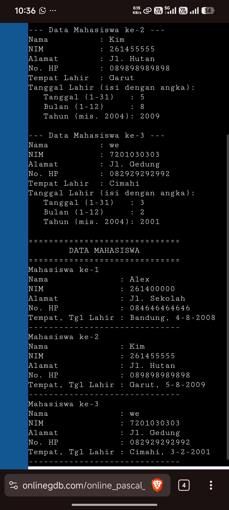

# Latihan 1 - Record (Pascal)

Program untuk menginput dan menampilkan biodata mahasiswa (nama, NIM, alamat, no. HP, tempat dan tanggal lahir) menggunakan array of record, record di dalam record, dan perulangan `for`.

## Hasil Program

